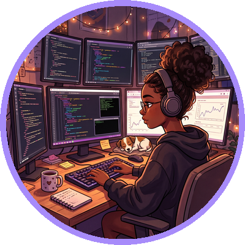

<!-- Paste into the README.md of a PUBLIC repo named exactly: Supriniiii
     Upload the whole /assets folder (banner, typing, footer and profile images) to the same repo. -->

 

---

## ✨ About me

<table>
<tr>
<td width="50%" valign="top">

**Who I am**
AI & Software Engineer who spent two years building production microservices and AI agent systems at **FNB**. I like turning complex, messy workflows into reliable, observable systems.

</td>
<td width="50%" valign="top">

**What I'm doing now**
Completing an **Advanced Diploma in Computer Science** at TUT (2028) and looking for my next role in AI, backend or platform engineering.

</td>
</tr>
</table>

---

## 🛠️ What I do

<table>
<tr>
<td width="25%" align="center" valign="top">

### 🤖 AI Agents
LLM agents, RAG, MCP servers and multi-agent orchestration

</td>
<td width="25%" align="center" valign="top">

### ⚙️ Backend
Java Spring Boot microservices, REST, gRPC and event-driven systems

</td>
<td width="25%" align="center" valign="top">

### ☁️ Cloud & DevOps
Docker, Kubernetes, CI/CD and API gateways

</td>
<td width="25%" align="center" valign="top">

### 📈 Observability
Tracing and monitoring with OpenTelemetry, Prometheus and Grafana

</td>
</tr>
</table>

---

## 🧰 Toolkit

 

 

---

## 🚀 Featured projects

<table>
<tr>
<td width="33%" valign="top">

### 🛒 Microservices E-Commerce
*Team project, Geeks4Learning learnership*

Angular frontend, Spring Boot services and PostgreSQL on Kubernetes with an API gateway.

**My role:** TODO one line on what you built

[View repo →](https://github.com/supriniiii/TODO-REPO-NAME)

</td>
<td width="33%" valign="top">

### 👤 finalUserService
TODO one line on what it does and the stack

**Stack:** TODO

[View repo →](https://github.com/supriniiii/finalUserService)

</td>
<td width="33%" valign="top">

### ♻️ WasteSortApplication
TODO one line on what it does and the stack

**Stack:** TODO

[View repo →](https://github.com/supriniiii/WasteSortApplication)

</td>
</tr>
</table>

---

## 🎓 Education & certifications

-TUT-7C3AED?style=flat-square)

---

## 💬 Let's connect

I'm open to AI engineering, software engineering and backend roles.
If you're hiring or want to collaborate, reach out. I'd love to hear from you.

# Supriniiii.github.io
