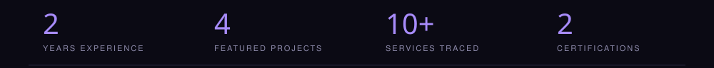
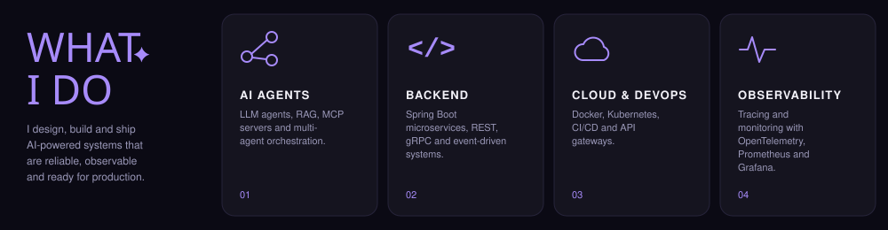
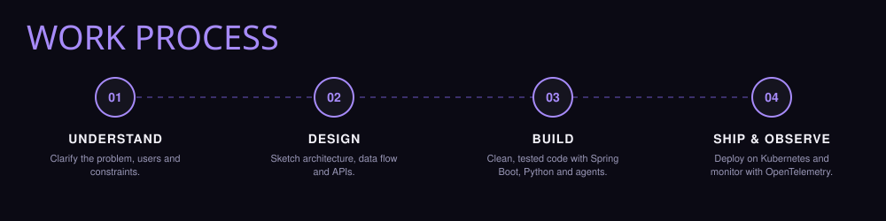
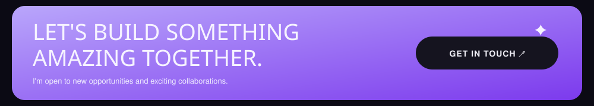

<!-- GitHub Special Profile README for Supriniiii -->

 

  

---

## ✨ About me

<table>
<tr>
<td width="50%" valign="top">

### 👤 Who I am
AI & Software Engineer with experience in building production microservices and AI agent systems. I'm passionate about building software that solves real-world problems, exploring artificial intelligence, and designing reliable backend systems. Through my experience in a banking technology environment, I've gained exposure to software development, AI initiatives, microservices, data engineering, and system observability. I like turning complex, messy workflows into reliable, observable systems.

</td>
<td width="50%" valign="top">

### 🎓 What I'm doing now
Completing an **Advanced Diploma in Computer Science** at TUT and looking for my next role in AI, backend, software, or platform engineering.

🤖 **Exploring:** AI agents, LLM applications, and intelligent automation.  
☕ **Building:** Backend applications with Java and Spring Boot.  
🐍 **Scripting:** Python for AI, data processing, and automation.  
☁️ **Deploying:** Containerisation, Kubernetes, and cloud technologies.  
📊 **Observing:** Monitoring, tracing, and data visualisation.  

**Goal:** Build useful, scalable, and intelligent software while growing as an engineering professional.

</td>
</tr>
</table>

---

## 🛠️ What I do

<table>
<tr>
<td width="20%" align="center" valign="top">

### 🤖 AI Agents
LLM agents, RAG, MCP servers, and multi-agent orchestration

</td>
<td width="20%" align="center" valign="top">

### ⚙️ Backend
Java, JavaScript, Python, Spring Boot microservices, REST, gRPC

</td>
<td width="20%" align="center" valign="top">
     
### 📱 Frontend
Angular, React, HTML5, CSS3, Node.js

</td>
<td width="20%" align="center" valign="top">

### ☁️ Cloud & DevOps
Docker, Kubernetes, CI/CD pipelines, and API gateways

</td>
<td width="20%" align="center" valign="top">

### 📈 Observability & Data
OpenTelemetry, Prometheus, Grafana, Distributed Tracing, Power BI

</td>
</tr>
</table>

---

## 🧰 Toolkit

 

 

---

## ⚡ Work Process

<table>
<tr>
<td width="25%" align="center" valign="top">
<b>01. DISCOVER</b> 
Understanding goals, target audience, and system requirements.
</td>
<td width="25%" align="center" valign="top">
<b>02. DESIGN</b> 
Structuring system architecture, wireframes, and data flows.
</td>
<td width="25%" align="center" valign="top">
<b>03. DEVELOP</b> 
Building clean, testable, microservice and AI solutions.
</td>
<td width="25%" align="center" valign="top">
<b>04. DELIVER</b> 
Observability testing, deployment, and performance tuning.
</td>
</tr>
</table>

---

## 🚀 Featured projects

<table>
<tr>
<td width="33%" valign="top">

### 🤖 Deep Agent Platform
Turns a natural-language request into a runnable Python agent project through a deterministic engineering pipeline. Includes CLI & 98 tests.

`Python` `LangChain` `Azure OpenAI` `ChromaDB` `pytest`

[View repo →](https://github.com/Supriniiii/SupriniDeepAgent)

</td>
<td width="33%" valign="top">

### 🧭 CareerPilot AI
AI career assistant: generates tailored resumes and cover letters (PDF/Word), scores readiness, and features an AI advisor chat.

`Next.js` `React` `TypeScript` `Tailwind` `Firebase` `Gemini`

[View repo →](https://github.com/Supriniiii/careePilot)

</td>
<td width="33%" valign="top">

### 🛒 AlgoBot E-Commerce
*Team project, Geeks4Learning*

Angular frontend, Spring Boot microservices, and PostgreSQL on Kubernetes with an API gateway.

`Angular` `Spring Boot` `Kubernetes` `PostgreSQL`

[View repo →](https://github.com/Geeks4LearningJHB/AlgoBot-Front-End)

</td>
</tr>
<tr>
<td width="33%" valign="top">

### ♻️ WasteSort App
Educational application to promote sustainable waste management practices with REST API guidelines.

`Java` `Spring Boot` `Spring Data REST` `H2` `JPA`

[View repo →](https://github.com/supriniiii/WasteSortApplication)

</td>
<td width="33%" valign="top">

### 🥕 FoodConnect
Connects customers, farmers, and food banks to cut food waste. Features role-based dashboards & recipe suggestions.

`PHP` `Bootstrap` `MySQL`

[View repo →](https://github.com/supriniiii/FoodConnect)

</td>
<td width="33%" valign="top">

### 🏙️ CivicFix Triage
Municipal service-request triage: ML model scores complaint urgency with FastAPI, Streamlit, and Next.js dashboards.

`Python` `FastAPI` `Streamlit` `Next.js`

[View repo →](https://github.com/Supriniiii/civic-triage)

</td>
</tr>
</table>

---

## 🎓 Education & certifications

---

## 📊 GitHub Activity

---

## 💬 Let's connect

  

I'm open to AI engineering, software engineering, and backend roles.  
If you're hiring or want to collaborate, reach out!

  

